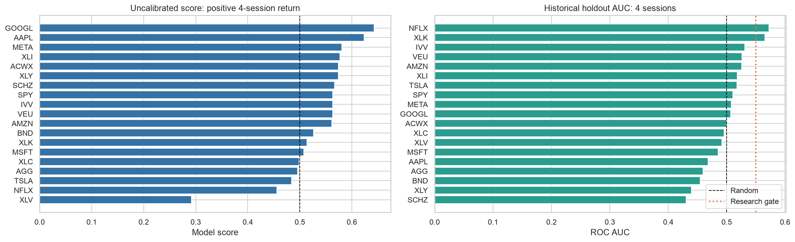

# Investment Track ML

**An auditable ML research tool developed to support the CaseKey Investment Track.**

The notebook studies the direction of future ETF and stock returns, compares models with simple baselines, and exports the evidence behind its research flags. It supports a documented investment process: examine data quality, test a hypothesis, record model limitations, and apply independent investment judgment.


## What it does

- Studies 19 instruments: 12 ETFs and seven stocks.
- Builds 12 price, volume, momentum, volatility, and market-context features.
- Compares Logistic Regression, Gradient Boosting, and XGBoost.
- Uses three expanding validation folds, horizon-sized gaps, and explicit label-boundary checks.
- Reserves the latest 15% of labeled history for a historical holdout.
- Compares Brier score, log loss, accuracy, and AUC with a constant baseline estimated from the training period.
- Exports scores, validation metrics, split evidence, data audits, method notes, and human-review templates.

## How it fits Investment Track

Use the tool as a supplementary research step after defining the investment mandate and eligible universe. Its outputs can support a research memo or a deliberate no-action decision. Policy eligibility, fundamentals, valuation, position sizing, funding, portfolio drawdown, and final decisions require separate evidence and human review.

The project does not execute trades or calculate official portfolio performance. It is an independently developed participant tool and is not an official CaseKey product. AI assistance was used in development and documentation.

## Quick start

Use Python 3.12. The pinned package set matches the environment used to validate this public edition.

```bash
python3.12 -m venv .venv
source .venv/bin/activate
python -m pip install -r requirements.txt
python -m unittest discover -s tests -v
python run_research.py --review-date 2026-11-10
```

The full research run requires an internet connection and trains many models. Provider availability, rate limits, and data revisions can affect execution and results. Tests use synthetic data and run offline after dependencies are installed.

On macOS, XGBoost also needs an OpenMP runtime. If importing XGBoost reports a missing `libomp.dylib`, install it using `brew install libomp` with Homebrew before running the project.

Alternatively, open [the notebook](notebooks/investment_track_ml.ipynb) in VS Code, Jupyter, or Colab and run cells in order. The installation cell installs the research dependencies in notebook environments.

`--review-date` is the **exclusive** download end. The default historical review uses completed bars through November 9, 2026. Change the date explicitly for another review; a historical example is not a current signal. A current-day exclusive end excludes that day's incomplete bar. Future dates are rejected.

```bash
python run_research.py --review-date YYYY-MM-DD --output-dir outputs
```

The runner uses the active Python interpreter as its notebook kernel and saves an execution record even when a cell fails. Outputs appear under `outputs/review_<date>/<UTC run ID>/`; a ZIP bundle is written alongside the run directory. Outputs and downloaded prices are ignored by Git.

## Method

| Step | Implementation |
| --- | --- |
| Data | Adjusted daily OHLCV from Yahoo Finance through `yfinance`; default start January 1, 2016 |
| Validation | Required finite values, positive prices, nonnegative volume, unique dates, exchange-session coverage, OHLC consistency, minimum 1,500 observations, and large-jump review |
| Features | 1/5/20-session returns; 20/60-session volatility; 20/50-session moving-average gaps; rolling log-volume z-score; daily range; 14-session RSI; SPY context |
| Target | Positive adjusted close-to-close return over a specified number of exchange sessions |
| Historical horizons | 4, 5, and 20 sessions for the default November 10 review |
| Model selection | Highest mean validation Brier improvement over each fold's training-frequency baseline |
| Historical holdout | Latest 15% of labeled observations, separated from development by a horizon-sized purge |
| Latest score | Selected model refit on all matured labels |
| Research gate | Positive mean validation Brier improvement, holdout AUC at least 0.55, and holdout Brier/log loss better than the pre-holdout baseline |

For the historical configuration, the optional November 13, 2026 cutoff adds the four-session horizon from the November 9 close. Five- and 20-session horizons extend beyond that cutoff. For later review dates, the notebook normally uses five and 20 sessions. Edit the configuration cell to change the universe or historical cutoff.

If the gate passes, scores at least eight percentage points above the training base rate are labeled a research candidate; scores at least eight points below it prompt a downside review. Other passing results are neutral. These thresholds are declared heuristics. A score is **uncalibrated**, not a verified probability of profit.

## Historical example

[Historical summary](examples/historical_summary.json) describes the archived original run, rather than a fresh execution of the public edition:

| Measure | Archived result |
| --- | --- |
| Review date / last completed session | November 10 / November 9, 2026 |
| Symbols / horizons / combinations | 19 / 3 / 57 |
| Split-boundary checks | 228, all training label ends before evaluation starts |
| Combinations passing the research gate | **0 of 57** |



The chart shows latest uncalibrated scores and historical holdout AUC for the four-session horizon. Data validation and split checks establish specific input and timing properties; they do not establish predictive skill or profitable execution. Original downloaded prices are excluded from this repository. Provider revisions mean a rerun is not guaranteed to reproduce these numbers exactly.

## Outputs

| File | Purpose |
| --- | --- |
| `ML_Signals.csv` | Latest model scores, selected models, holdout metrics, and research flags |
| `Validation.csv` | Validation results for all models plus selected-model holdout results |
| `Split_Audit.csv` | Train/evaluation dates, row counts, and label-end boundaries |
| `Data_Audit.csv` | Download metadata, date coverage, row counts, and price-file SHA-256 hashes |
| `Data_Errors.csv` | Rejected downloads when verification fails; models do not run |
| `Horizons.csv` | Target start/end dates and relation to the historical cutoff |
| `Human_Review.csv` / `Trade_Memos.csv` | Blank evidence and decision templates |
| `Method.csv` / `Run_Manifest.json` | Method description, configuration, and dependency versions |
| `Model_Diagnostics.png` | Score and holdout-AUC chart |

## Limits

- The holdout has been used in repeated historical research and in the gate itself. It is not an untouched prospective test.
- Overlapping labels, correlated funds, and multiple comparisons limit interpretation. No significance test or multiple-testing correction is implemented.
- Adjusted historical prices can be revised and are not a point-in-time archive. These inputs do not model information arrival or execution latency.
- There is no costed strategy backtest, probability calibration, expected-return model, transaction-cost model, or slippage model.
- No model output replaces policy compliance, fundamental research, portfolio-risk review, or investment judgment.
- Original personal account data, policy documents, screenshots, correspondence, and meeting materials are excluded. This publication does not validate account performance or historical compliance.

## Validation

The public edition was validated on November 13, 2026 with Python 3.12.14 and the pinned dependencies. Seven offline checks passed, including feature causality, target alignment, label-leakage rejection, training-only baselines, gate behavior, and model selection/refitting on synthetic history. A complete historical run of the public notebook also succeeded for all 19 symbols and 57 combinations, with all 57 returning insufficient model evidence. Local generated outputs are not included in the repository.

## Project files

```text
notebooks/investment_track_ml.ipynb   Research workflow
run_research.py                      Local notebook runner
requirements.txt                    Pinned environment
examples/                           Archived aggregate findings and diagnostics
tests/test_research.py               Offline methodology and pipeline checks
```

Method references: [time-series splitting](https://scikit-learn.org/stable/modules/generated/sklearn.model_selection.TimeSeriesSplit.html), [probability calibration](https://scikit-learn.org/stable/modules/calibration.html), and [yfinance downloads](https://ranaroussi.github.io/yfinance/reference/api/yfinance.download.html).

The source code is provided for educational research. No license grant is included; data providers' terms also apply to downloaded data. This project is not investment advice.
